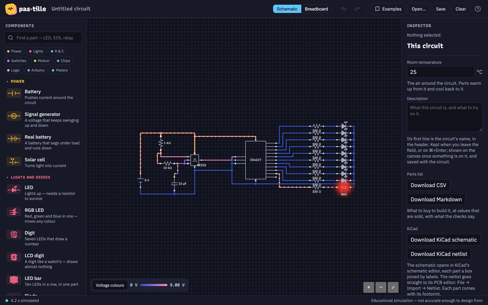
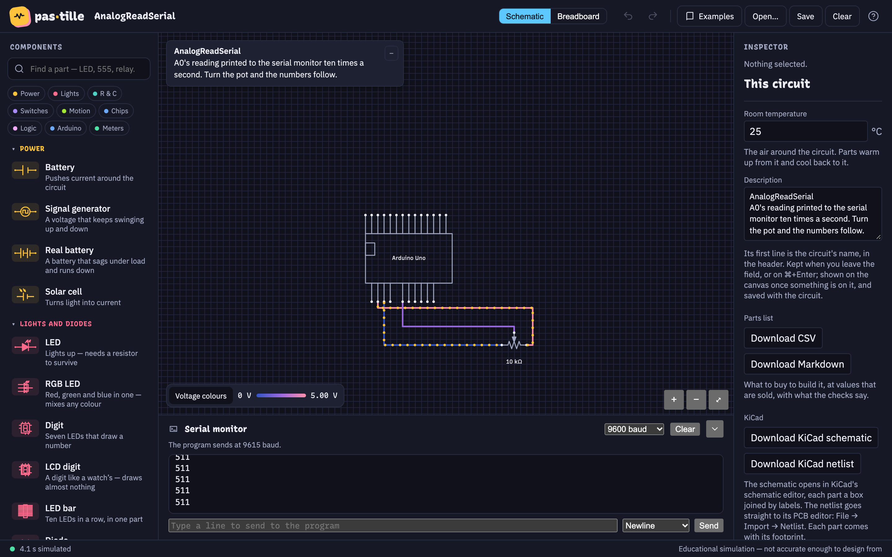
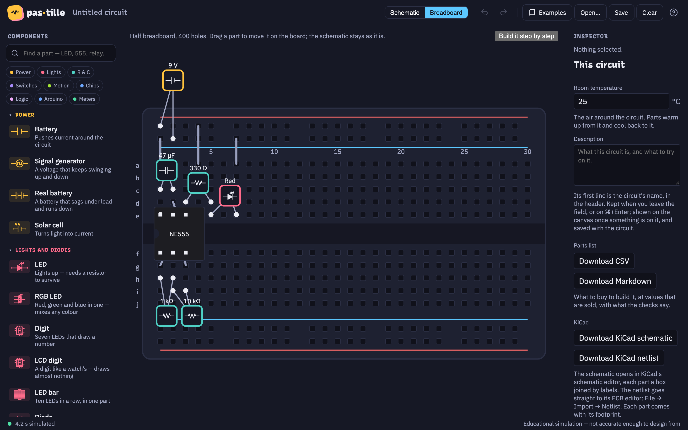
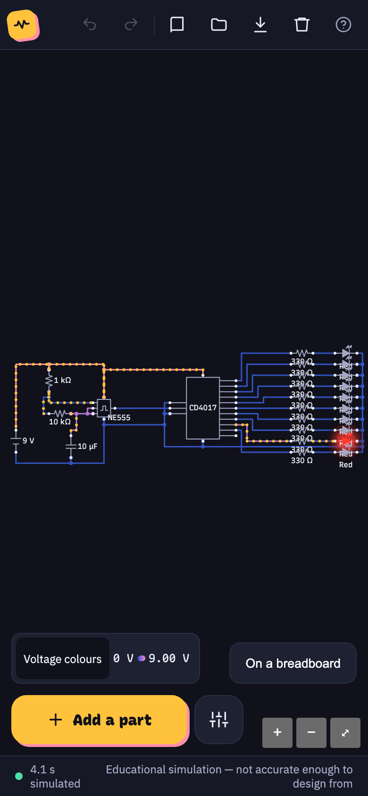

<div align="center">


# Pastille

**An electronics simulator for people who have never built a circuit,<br>and the bridge from a
circuit that works on screen to one that works on your desk.**


</div>



Most circuit simulators are built for people who already know what a node voltage is. Pastille is
built for the person who just bought a starter kit and wonders why the LED did not light up. Drop
a battery, a resistor and an LED, wire them, and **watch it work**: the current moves along the
wires, every wire takes the colour of its voltage, and when something is wrong, Pastille says what
and why, in a sentence, before anything burns.

- **See electricity move.** Dots flow with the current, faster where more of it flows. Wires go
  from blue at 0 V to pink at the supply. A part that runs hot warms up, and cools back down.
- **Mistakes, explained.** An LED the wrong way round, a short across the battery, a chip with no
  power, a resistor asked to burn more than it is rated for: Pastille spots them as you wire, says
  what would happen on a real bench, and how to fix it.
- **Real parts, real limits.** Every part is modelled from what its datasheet promises: batteries
  that sag and run down, regulators that drop out, fuses that blow, LEDs that die past their
  current.

## What's inside

### 56 parts, from a battery to an Arduino

Batteries and a solar cell, signal generators, a transformer and a bridge rectifier, resistors,
capacitors and coils, LEDs, RGB LEDs and LED bars, seven-segment and LCD digits, switches, relays
and fuses, transistors and MOSFETs, regulators, op-amps, the 555, decade counters, digit
decoders, flip-flops, logic gates, a shift register, a motor driver, an optocoupler, sensors, a
servo and a motor. Search them by name or by what they do ("LED, 555, relay").

### An Arduino Uno that runs real programs



The Uno is not a pretend one: it runs the compiled program of a real Arduino sketch, instruction
by instruction, on an emulated ATmega328P. Blink, Fade, a traffic light, a thermometer, a servo
sweep: wire the Uno to the rest of the circuit and the pins drive it. Programs that print get a
**serial monitor** beside the board, and you can type back to them.

### 111 examples, one click away

From "an LED and a resistor" to a 555 chasing ten LEDs through a decade counter, each example is a
working circuit with a sentence on what to try on it: turn the pot, press the button, pull the
fuse. Open one, break it, and see what Pastille says.

### From the screen to the bench

When a circuit works, Pastille helps you build it for real:



- **On a breadboard**: the same circuit laid out on a half breadboard, with a **step by step**
  guide to place each part and wire.
- **A parts list** to buy from, as CSV or Markdown, at values that are actually sold.
- **KiCad**: export the schematic, or the netlist straight into KiCad's PCB editor, each part with
  its footprint.

### Anywhere, even offline



Pastille runs in the browser: the simulator is written in Rust and compiled to WebAssembly, so
it solves your circuit on your own machine, with nothing sent anywhere. Install it from the
browser and it works with no network at all. On a phone, the circuit gets the whole screen, and
parts are a tap away. On a Mac, on Windows and on Linux, it also comes as an app of its own.

Your circuit is saved as you go, and as a plain JSON file when you ask.

<br clear="right">

> Pastille is an **educational** simulator: it shows how a circuit behaves, not to the precision
> you would design a product with. It says so at the bottom of the screen, always.

## Getting started

### Download the app

From the [releases](https://github.com/Srynetix/pastille/releases), the file for your system:

| System | File |
|---|---|
| macOS, Apple Silicon or Intel | `Pastille_<version>_macos-universal.dmg` |
| Windows, most PCs | `Pastille_<version>_windows-x64-setup.exe` (`windows-arm64` for ARM ones) |
| Debian, Ubuntu and their derivatives | `Pastille_<version>_amd64.deb` (`arm64` for ARM, a Raspberry Pi 4 or 5) |
| Arch Linux and its derivatives | `Pastille_<version>_amd64.pkg.tar.zst` |
| Any other Linux | `Pastille_<version>_amd64.AppImage` (`arm64` likewise) |

None of them is signed, so each system warns the first time:

- **macOS** refuses to open it. Remove the quarantine flag once,
  `xattr -dr com.apple.quarantine /Applications/Pastille.app`, or after a first refused
  launch, choose **Open Anyway** in System Settings › Privacy & Security.
- **Windows** SmartScreen stops the installer: **More info › Run anyway** installs it.
- **Linux**: `sudo apt install ./Pastille_<version>_amd64.deb`, on Arch
  `sudo pacman -U Pastille_<version>_amd64.pkg.tar.zst`, or else make the AppImage
  executable (`chmod +x`) and run it; it needs libfuse2 (`sudo apt install libfuse2`, or
  `libfuse2t64` on Ubuntu 24.04).

### Build it

Prerequisites: [Rust](https://rustup.rs) with the `wasm32-unknown-unknown` target,
[wasm-pack](https://rustwasm.github.io/wasm-pack/), Node.js with [pnpm](https://pnpm.io), and
[just](https://just.systems). For the desktop app, the
[Tauri prerequisites](https://v2.tauri.app/start/prerequisites/) too.

```bash
just doctor   # what this machine is missing, if anything
just install  # the app's dependencies
just dev      # build the simulator and serve the app on http://localhost:5173
just dev-lan  # the same, reachable from a phone on your network
just desktop  # the desktop app for this machine, in desktop/target/release/bundle
```

<details>
<summary><b>Development</b></summary>

Recipes live in the `justfile`; `just` on its own lists them.

```bash
just ci       # the gate: formatting, lints, licences, every test, a cold load and an offline run
just test     # the core's tests and the app's, in a real browser
just run app/src/examples/milestone.json   # a saved circuit, simulated without a browser
just desktop-universal   # one Mac app for Apple Silicon and Intel
just windows  # the Windows installer, from the Mac: scripts/windows.sh --help for its tools
just linux    # the Linux .deb and AppImage, from the Mac, in Docker; --bundles deb,appimage,pacman adds Arch's
just pages    # the web app as GitHub Pages serves it, checked offline
just release --dry-run   # what a release would publish: just release --help
```

There is no hosted pipeline: `just ci` passing is what says a change is good. Run it on mains
power, as its benchmarks are calibrated to a machine that is not throttling.

| Part | Role |
|---|---|
| `crates/core` | The simulator: netlist, solver, part models, the checks, the AVR, the exports. Rust, compiled to WebAssembly for the app |
| `crates/runner` | `pastille-run`, a saved circuit simulated from the command line |
| `app` | The interface, in Svelte 5 and TypeScript |
| `desktop` | The desktop app, a Tauri shell around the same build, for macOS, Windows and Linux |
| `programs` | The Uno's example sketches and the programs built from them |
| [`docs/adrs`](docs/adrs/README.md) | Every technical decision so far, and why |

</details>

## How it was made

Pastille was designed, tested and used every day by its author, with the help of an AI coding
agent ([Claude Code](https://claude.com/claude-code)). The agent wrote most of the code and the
tests under the author's direction; the design decisions, the testing on real machines and the
choice of what ships remain the author's. It is part of the
[P suite](https://github.com/Srynetix/p-suite), apps made this way.

## Contributing

Bug reports, ideas and pull requests are welcome: [CONTRIBUTING.md](CONTRIBUTING.md) says how,
and [SECURITY.md](SECURITY.md) how to report a security problem privately.

## License

Dual-licensed under either of [MIT](LICENSE-MIT) or [Apache 2.0](LICENSE-APACHE), at your
option. Unless you state otherwise, any contribution you submit for inclusion is dual-licensed
the same way, with no additional terms.

No copyleft code is in this repository: CircuitJS and Fritzing were studied as prior art, and
what was reused from them is ideas, reimplemented ([ADR 0001](docs/adrs/0001-permissive-dual-licence.md)).
The example programs contain Arduino's AVR core, under the LGPL 2.1: see
[programs/NOTICE.md](programs/NOTICE.md).
