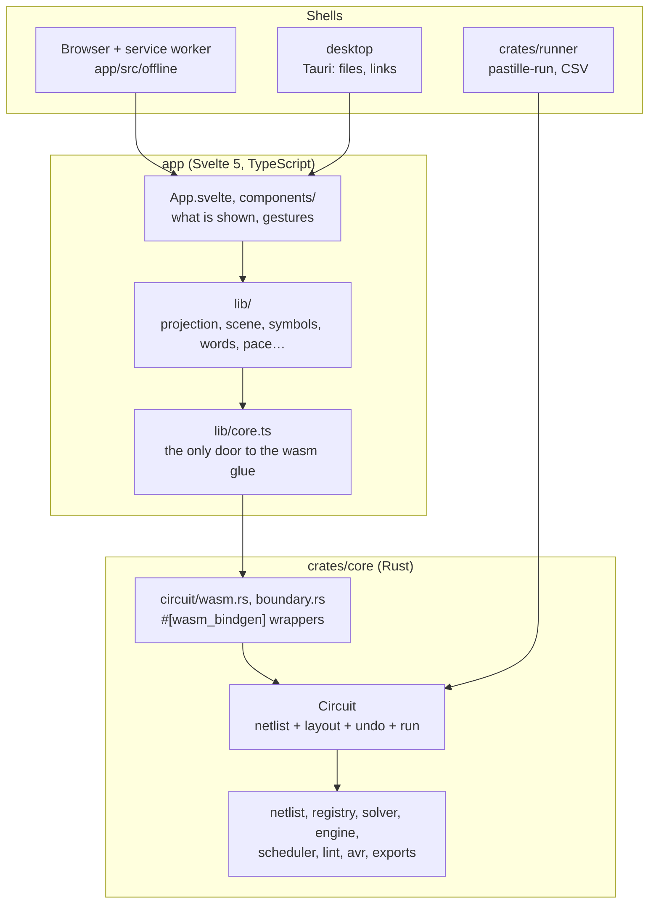
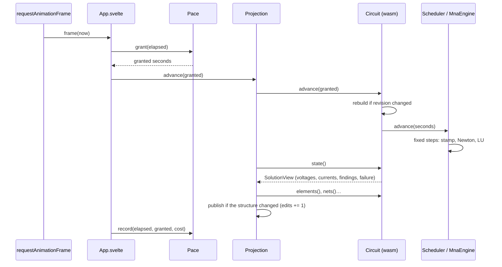

# Architecture

## Layers

Dependencies point down. Nothing in `crates/core` knows a canvas, a DOM or a file system; the
app knows the core only through `lib/core.ts`; the shells add what a browser cannot do and
simulate nothing.

| Layer | Holds | May depend on | Checked by |
|---|---|---|---|
| `crates/core` | Everything true about a circuit: the netlist, the parts' models, the solver, the linter, the AVR, the file format, the exports | `serde`, `slotmap`, `wasm-bindgen`, `tsify` | Cargo: the crate has no other dependency |
| `crates/runner` | A saved circuit run from the command line, printed as CSV | `pastille-core`, `serde_json` | Cargo |
| `app/src/lib` | What the app makes of the core's answers: drawing, routing, words, units, pacing, files | `core.ts` alone for the core | `just boundary` |
| `app/src/App.svelte`, `components/` | What is on screen, and turning gestures into calls on the circuit | `lib/` | `just boundary`, review |
| `desktop` | Saving, opening and following links through the system | Tauri, the built app | Its own workspace, `just desktop-check` |

The core is built twice: to WebAssembly for the app (`just wasm`, into `app/src/lib/wasm/`,
generated, never edited) and natively for its tests and the runner. Its wasm face is a set of
thin wrappers over native functions, so almost every path is tested by `cargo test` without a
browser.

## Modules

### `crates/core`

| Module | Role |
|---|---|
| [`netlist`](../../crates/core/src/netlist/mod.rs) | Elements, pins, nets, `ElementKind`; `compile` numbers the nodes and picks each circuit's reference ([ADR 0003](../adrs/0003-implicit-ground.md)); `connectivity` answers what is joined |
| [`registry`](../../crates/core/src/registry.rs) | One entry per kind: pins, unit, defaults, ratings, thermal data ([ADR 0008](../adrs/0008-component-registry.md)) |
| [`check`](../../crates/core/src/check.rs), [`value`](../../crates/core/src/value.rs), [`series`](../../crates/core/src/series.rs) | Which values a part accepts; `4k7` read as people write it; the E-series a value is sold in |
| [`circuit`](../../crates/core/src/circuit.rs) | The circuit the app holds: edits (`edit.rs`), what to draw and what the run says (`read.rs`, `views.rs`), words per kind (`labels.rs`), exports (`exports.rs`), its face to JavaScript (`wasm.rs`) |
| [`document`](../../crates/core/src/document.rs), [`json`](../../crates/core/src/json.rs) | The saved file and its `SCHEMA`; JSON through the browser's own parser in wasm, `serde_json` natively |
| [`engine`](../../crates/core/src/engine/mod.rs) | The `Engine` trait the circuit simulates through, and `MnaEngine` behind it |
| [`scheduler`](../../crates/core/src/scheduler.rs) | Wall time in, fixed steps out |
| [`solver`](../../crates/core/src/solver/mod.rs) | `mna` (the matrix), `lu` ([ADR 0004](../adrs/0004-own-lu-solver.md)), `newton`, `dc`, `transient`, `integration`, `heat`, and `device/`: one model per part |
| [`lint`](../../crates/core/src/lint/mod.rs) | The rules a circuit is reviewed by, one function each in `rules.rs` |
| [`avr`](../../crates/core/src/avr/mod.rs) | The ATmega328P: CPU, instructions, ports, timers, ADC, USART, Intel HEX ([ADR 0017](../adrs/0017-the-avr-in-the-core.md)) |
| [`serial`](../../crates/core/src/serial.rs), [`scope`](../../crates/core/src/scope.rs) | What a serial monitor hears at its baud; what each probe has read over time |
| [`breadboard`](../../crates/core/src/breadboard.rs), [`build`](../../crates/core/src/build.rs), [`catalogue`](../../crates/core/src/catalogue.rs), [`kicad`](../../crates/core/src/kicad.rs), [`replace`](../../crates/core/src/replace.rs) | From the screen to the bench: holes, build steps, real part numbers, a KiCad netlist, swapping a part's kind |
| [`boundary`](../../crates/core/src/boundary.rs) | The wasm boundary's two mechanisms ([ADR 0002](../adrs/0002-wasm-boundary-serialization.md)) |

### `app/src`

| Module | Role |
|---|---|
| [`App.svelte`](../../app/src/App.svelte) | The shell: owns the projection, runs the frame loop, turns the components' events into calls on the circuit |
| `components/` | `Canvas` (schematic), `Breadboard`, `Palette`, `Inspector`, `Scope`, `SerialMonitor`, `StatusBar`… Each draws what it is given and reports gestures through `on…` callbacks |
| [`lib/core.ts`](../../app/src/lib/core.ts) | Loads the wasm core once, re-exports its types |
| [`lib/projection.svelte.ts`](../../app/src/lib/projection.svelte.ts) | Advances the circuit and reads it back, every frame |
| `lib/scene.ts`, `render.ts`, `routing.ts`, `viewport.ts` | Circuit to scene, scene to canvas calls, wire routes, world and screen coordinates |
| `lib/symbols.ts`, `palette.ts`, `glyph.ts` | How each kind is drawn and what it is called ([ADR 0008](../adrs/0008-component-registry.md)) |
| `lib/readings.ts`, `units.ts`, `steady.ts`, `voltage.ts`, `heat.ts`, `failures.ts` | Numbers, colours and sentences from what the solver said |
| `lib/pace.ts` | How much simulated time a frame can afford |
| `lib/circuitfile.ts`, `desktop.ts`, `examples.ts`, `programs.ts` | Saving, opening, autosave; the desktop's dialogs; the bundled examples and Uno programs |
| `lib/keys.ts`, `contacts.ts`, `placement.ts` | Key bindings as a table; what a press means for a switch or a button; dragging a part out of the palette |

## Threads

There is one. The app and the wasm core run on the page's main thread; the simulation advances
inside `requestAnimationFrame`. No worker, no shared memory. What keeps the page responsive is
`Pace`, which grants each frame only the simulated time the previous frames could afford, and
the status bar says when the circuit runs slower than real time.

## Main flows

### A frame

Svelte then redraws what depends on what changed: the canvas every frame (the solution is new
by nature), the inspector and the autosave only when `edits` moved.

### An edit

1. A component reports a gesture (`Canvas`'s `onwire`, `onmove`, `onpress`…; the palette's
   drop; the inspector's field).
2. `App.svelte` calls the circuit: `add`, `connect`, `remove`, a setter. A gesture of several
   calls (a drag, a multiple delete) sits between `beginGesture` and `endGesture`, so it is one
   step of undo.
3. The circuit checks the value (`check.rs`), changes the netlist, takes an undo snapshot and
   bumps its `revision`.
4. On the next `advance`, the circuit hands the edited netlist to the existing engine
   (`Engine::adopt`), so what the run holds (a capacitor's charge, the Uno's program) outlives
   the edit; then the frame reads the new structure back.

The app never mutates its own copy: what it draws is always what the core says.

### Saving and opening

`Circuit::to_document` and `from_document` are the format, `json.rs` the text. In the app,
`circuitfile.ts` writes the text to a download (or through the desktop's dialog, `desktop.ts`)
and to `localStorage` as an autosave. Examples in `app/src/examples/` are ordinary saved files,
and `just run <file>` simulates any of them without a browser.

## Platform code

| Where | What it reaches |
|---|---|
| [`circuit/wasm.rs`](../../crates/core/src/circuit/wasm.rs), [`boundary.rs`](../../crates/core/src/boundary.rs), the `#[wasm_bindgen]` items of `lib.rs` | JavaScript, through `wasm-bindgen`; values through `serde-wasm-bindgen` and `tsify` |
| [`json.rs`](../../crates/core/src/json.rs) | The browser's `JSON` in wasm, `serde_json` natively |
| [`lib/core.ts`](../../app/src/lib/core.ts) | The generated glue in `lib/wasm/` |
| [`lib/circuitfile.ts`](../../app/src/lib/circuitfile.ts), [`lib/once.ts`](../../app/src/lib/once.ts) | Downloads, file inputs, `localStorage` (every access guarded: Safari's private mode throws) |
| [`lib/sound.ts`](../../app/src/lib/sound.ts) | Web Audio, for buzzers |
| [`app/src/offline/sw.js`](../../app/src/offline/sw.js) | The service worker that serves the app offline ([ADR 0009](../adrs/0009-own-offline-shell.md)) |
| [`lib/desktop.ts`](../../app/src/lib/desktop.ts) → [`desktop/src/main.rs`](../../desktop/src/main.rs) | Tauri commands: `save_circuit`, `open_circuit`, `open_program`, `open_link`, `smoke_report` |

## Departures from § 12

- **The wasm binding lives in the core crate.** `Circuit` carries `#[wasm_bindgen]`, and
  `wasm-bindgen`, `tsify` and `serde-wasm-bindgen` are dependencies of `pastille-core`. The
  binding is confined to `circuit/wasm.rs`, `boundary.rs`, `json.rs` and a few attributes, and
  every wrapper calls a `try_*` method that the native tests reach; a separate binding crate
  would be the clean form, at the cost of a second crate to build to wasm.
- **The comments carry history.** About 1,500 references to planning tickets (`C-24`, `M-21`,
  `B-12`, `A-06`) and about fifty to a "design doc" and a "prior-art study", all of them the
  author's own and not public (the [ADR index](../adrs/README.md) says so). Many module headers tell how the code came to be rather than why it is so. § 12
  says a comment never says when; until the code around them is touched, read a ticket number as
  noise, and when touching it, drop the reference if the sentence stands without it and move
  the story to an ADR if it is a decision.
- **`App.svelte` is about 2,900 lines.** It is the composition root and the handler of every
  gesture. The rules it applies are in `lib/` and in the core, so it decides little, but it is
  the file to split first: by panel, or by gesture family.
- **The zero-copy data plane of [ADR 0002](../adrs/0002-wasm-boundary-serialization.md) is not
  used.** `SolverFrame` exists and is tested, but the app reads each frame's solution through
  `Circuit::state()`, as a serialised `SolutionView`; the benchmark in `just ci` keeps that
  cost in check.
- **The app's tests are mostly in large files.** `components/shell.test.ts` (about 2,500 lines)
  drives the whole shell in a real browser; `crates/core/src/circuit/tests.rs` (about 6,300)
  covers the circuit end to end. Both are worth splitting by feature when next extended.
